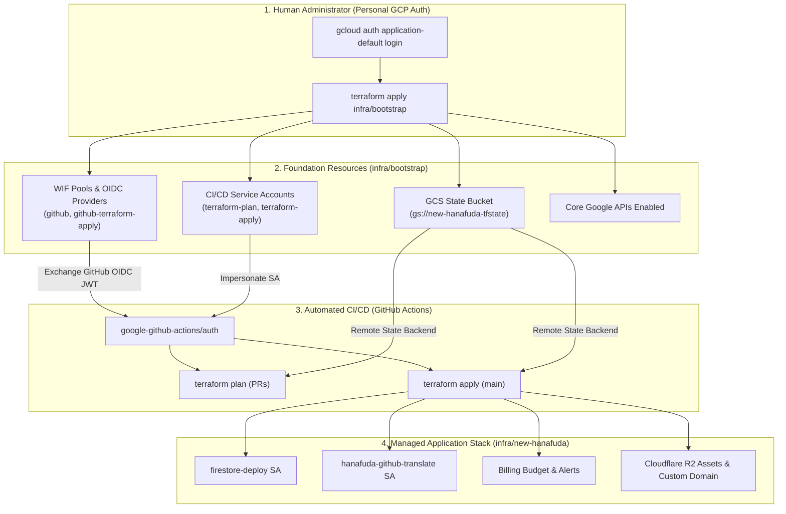

# Infrastructure Architecture & Dependency Model

This document explains why the Google Cloud infrastructure for `new-hanafuda` is divided into two separate Terraform root modules (`infra/bootstrap` and `infra/new-hanafuda`), why it is impossible to provision everything in a single `terraform apply`, and the exact dependency graph connecting the layers.

---

## 1. Overview & Two-Tier Architecture

The infrastructure is split into two distinct tiers with separate lifecycles, states, and execution identities:

| Tier | Directory | State Location | Applied By | Primary Responsibility |
| :--- | :--- | :--- | :--- | :--- |
| **Foundation (Tier 0)** | [`infra/bootstrap`](file:///Users/andrehammons/Projects/new-hanafuda/infra/bootstrap) | `gs://new-hanafuda-tfstate/bootstrap/` | Human operator (Andre) locally with personal credentials (`gcloud auth`) | State storage, Workload Identity Federation (WIF) pools/providers, root IAM, and CI/CD service accounts. |
| **Application (Tier 1)** | [`infra/new-hanafuda`](file:///Users/andrehammons/Projects/new-hanafuda/infra/new-hanafuda) | `gs://new-hanafuda-tfstate/new-hanafuda/` | Automated GitHub Actions CI/CD via keyless WIF | Application identities (`firestore-deploy`, `hanafuda-github-translate`), billing budget, Firestore/Firebase resources, and asset infrastructure. |

---

## 2. Why a Single Apply Is Impossible

There are four fundamental technical and security barriers that prevent standing up the entire infrastructure in a single apply:



### Barrier 1: The Remote Backend "Chicken-and-Egg" Problem
Terraform initializes its backend (`terraform init`) **before** evaluating or creating any resources in the graph.
- To store Terraform state remotely in Google Cloud Storage (`backend "gcs"`), the GCS bucket (`new-hanafuda-tfstate`) must already exist.
- If a single module attempted to create `google_storage_bucket.tfstate` while declaring `backend "gcs" { bucket = "new-hanafuda-tfstate" }`, Terraform would fail during `init` because the bucket does not yet exist to read or write state locks.

### Barrier 2: The Keyless CI/CD Bootstrapping Barrier
The repository enforces a strict **no service-account JSON keys** policy, authenticating exclusively via GitHub Actions Workload Identity Federation (WIF).
- CI/CD requires an existing WIF Pool, Provider, and Service Account (`terraform-plan` or `terraform-apply`) to authenticate to Google Cloud.
- A GitHub Actions workflow cannot provision its own WIF pool or its own Service Account, because it needs that WIF pool to authenticate to GCP in the first place.
- Therefore, an authenticated human administrator with Project Owner/Admin permissions must provision the foundation out-of-band.

### Barrier 3: Privilege Escalation & Security Blast Radius
Separating foundation management from application management enforces the Principle of Least Privilege:
- **`terraform-plan`**: Runs on unmerged pull requests (potentially from forks or untrusted branches). It has strictly read-only metadata permissions and cannot view sensitive data or acquire admin roles.
- **`terraform-apply`**: Runs only on merges to `main` within an approved GitHub Environment (`terraform`). It has scoped permissions to manage application service accounts and services.
- **The Self-Modification Risk**: If `infra/bootstrap` were inside the managed pipeline, an automated pull request could modify the WIF trust conditions, grant broad `roles/owner` privileges to its own runner, or alter the root IAM bindings. Keeping `bootstrap` strictly manual ensures that CI/CD can never escalate its own permissions.

### Barrier 4: State File & Lifecycle Isolation
- Foundation infrastructure changes rarely (usually once at project inception).
- Application infrastructure changes continuously as features are added.
- Splitting the state files (`prefix = "bootstrap"` vs `prefix = "new-hanafuda"`) ensures that a state lock or corruption during frequent application deployments can never break or lock the root security foundation.

---

## 3. Dependency Graph Between Modules

The application stack (`infra/new-hanafuda`) directly depends on resources provisioned by `infra/bootstrap`:

```
infra/bootstrap (Applied First by Human)
│
├── google_storage_bucket.tfstate (gs://new-hanafuda-tfstate)
│   └── REQUIRED BY: infra/new-hanafuda/backend.tf (State storage & locking)
│
├── google_project_service.required (APIs: iam, cloudresourcemanager, etc.)
│   └── REQUIRED BY: all GCP API calls in infra/new-hanafuda
│
├── module.github_wif (Workload Identity Pool: "github")
│   ├── REQUIRED BY: infra/new-hanafuda/locals.tf (local.workload_identity_provider)
│   ├── REQUIRED BY: infra/new-hanafuda/firestore.tf (firestore_deploy_wif binding)
│   └── REQUIRED BY: infra/new-hanafuda/translate.tf (translate_wif binding)
│
├── module.github_wif_apply (Workload Identity Pool: "github-terraform-apply")
│   └── REQUIRED BY: .github/workflows/terraform-apply.yml (CI authentication)
│
└── google_service_account.terraform_apply
    └── REQUIRED BY: .github/workflows/terraform-apply.yml (runner identity)
```

---

## 4. Operational Boundaries

1. **When to touch `infra/bootstrap`**:
   - Only when enabling new core GCP APIs, modifying Workload Identity Federation provider conditions (e.g. branch or repository claims), or modifying the permissions granted to `terraform-plan` and `terraform-apply`.
   - **Applied only by an operator** using `gcloud auth application-default login` from a trusted local workstation.
2. **When to touch `infra/new-hanafuda`**:
   - For all day-to-day infrastructure changes: adding application service accounts, configuring Cloud Storage asset buckets, Cloud CDN, Firestore rules deployers, billing budgets, etc.
   - **Planned automatically on pull requests** via `.github/workflows/terraform-plan.yml`.
   - **Applied automatically on `main`** via `.github/workflows/terraform-apply.yml` after manual approval in the `terraform` GitHub Environment.
